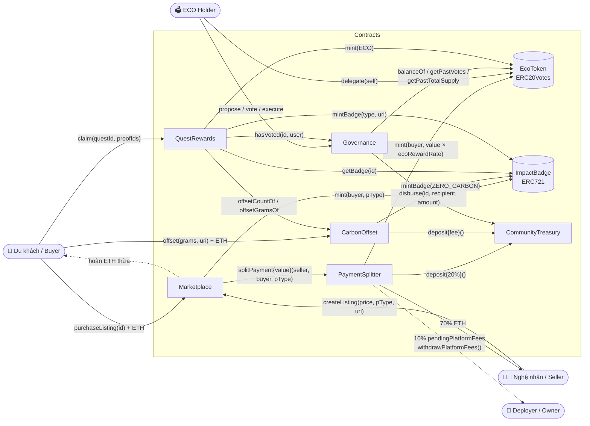
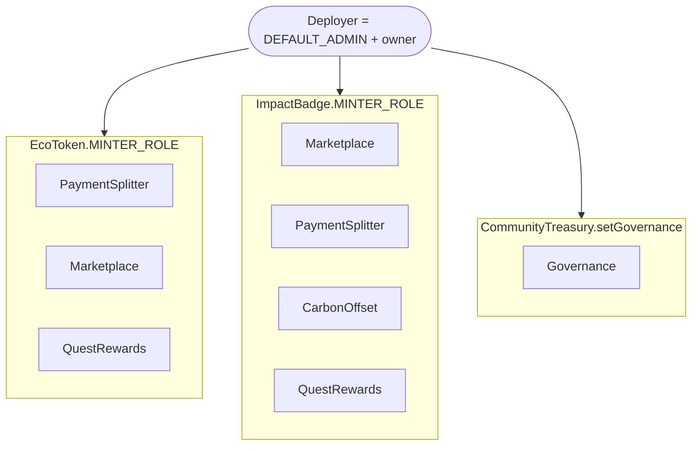
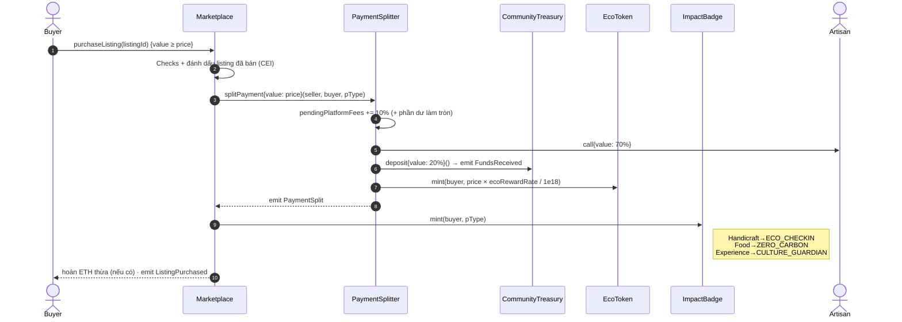
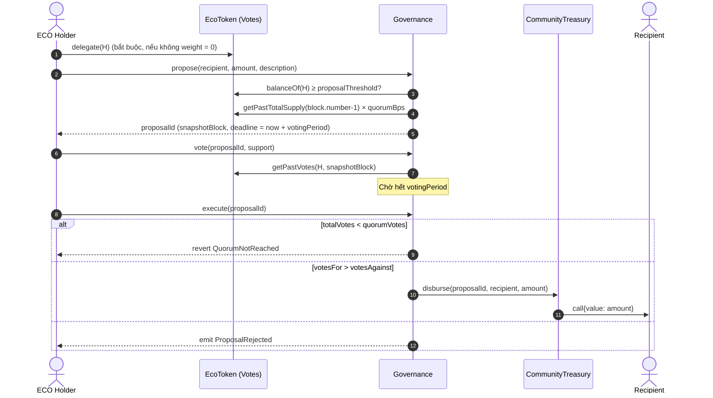
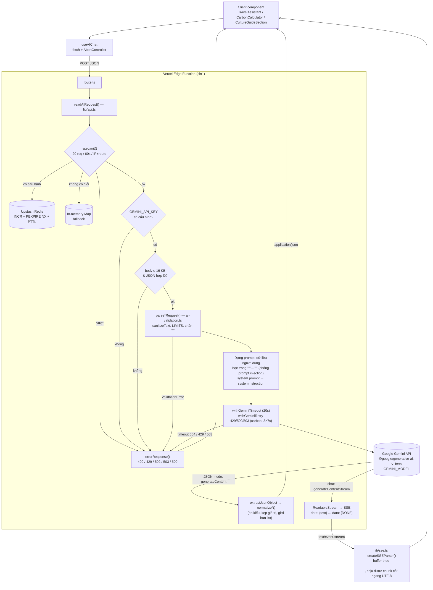

# CLAUDE.md — MyHomeLab (Regenerative Digital Eco-Tourism)

Tài liệu định hướng cho Claude Code (và lập trình viên mới) khi làm việc trong repo này.
Mô tả nghiệp vụ chi tiết nằm ở [README.md](README.md), [docs/PLAN.md](docs/PLAN.md),
địa chỉ đã deploy ở [docs/DEPLOYMENTS.md](docs/DEPLOYMENTS.md), báo cáo audit Lighthouse
(hiệu năng, accessibility, SEO) ở [docs/AUDIT_REPORT.md](docs/AUDIT_REPORT.md).
Smart contract **chưa** được audit bảo mật bởi bên thứ ba.

---

## 1. Tổng quan repo

```
HomeLab/
├── contracts/            # Foundry: Solidity 0.8.24, OpenZeppelin (git submodule)
│   ├── src/              # 8 contracts + interfaces/IMarketPlaceDeps.sol
│   ├── script/           # Deploy.s.sol (master), DeployCarbonOffset, DeployQuestRewards,
│   │                     # QuestSetup.sol (6 quest mặc định), interactions/*.sh (E2E bằng cast)
│   ├── test/             # forge test (unit + MarketplaceIntegration)
│   ├── deployments/      # local.json / sepolia.json do Deploy.s.sol ghi ra
│   └── Makefile          # build, test, deploy-local, deploy-sepolia, simulate-e2e...
├── frontend/             # Next.js 14 App Router, TypeScript, Tailwind, wagmi v2 + viem, ConnectKit, Three.js
│   ├── src/app/api/      # Route handlers: ai/chat, ai/itinerary, ai/culture-guide, carbon/calculate (Edge), ipfs/metadata (Node)
│   ├── src/lib/          # gemini.ts, api.ts, ai-validation.ts, rate-limit.ts, sse.ts, ...
│   ├── src/hooks/        # useMarketplace, useGovernance, useCarbonOffset, useQuestProgress, useAIChat...
│   ├── src/config/       # contracts.ts (địa chỉ + ABI theo chain), wagmi.ts
│   ├── src/abis/         # ABI JSON copy từ contracts/out/ (định dạng artifact Foundry: { "abi": [...] })
│   ├── test/             # unit test Node (node --test, *.test.mjs)
│   └── e2e/              # Playwright + Anvil (global-setup tự deploy contracts)
├── .github/workflows/    # ci.yml (forge test, typecheck, lint, unit, e2e) · deploy.yml (Vercel)
└── docs/
```

**Chain hỗ trợ:** Sepolia (`11155111`) và Anvil (`31337`). Chain mặc định lấy từ
`NEXT_PUBLIC_CHAIN_ID`, fallback Sepolia.

---

## 2. Smart Contracts

### 2.1 Danh sách contract

| Contract | Kế thừa | Vai trò |
| --- | --- | --- |
| `EcoToken` | ERC20, Capped (100M), Burnable, Permit, **Votes**, AccessControl, Ownable | Token thưởng + voting power (cần `delegate()` mới có phiếu) |
| `ImpactBadge` | ERC721, URIStorage, AccessControl | NFT Proof-of-Action: `ECO_CHECKIN`, `ZERO_CARBON`, `CULTURE_GUARDIAN`, `COMMUNITY_DONOR` |
| `PaymentSplitter` | Ownable, ReentrancyGuard | Chia tiền 70/20/10 (BPS), mint ECO cho người mua, phí platform theo pull-pattern |
| `Marketplace` | Ownable, ReentrancyGuard | Tạo/mua/huỷ listing D2C, hoàn tiền thừa |
| `CommunityTreasury` | Ownable, ReentrancyGuard | Giữ ETH cộng đồng; **chỉ Governance** gọi được `disburse()` |
| `Governance` | Ownable, ReentrancyGuard | DAO: `propose` → `vote` (snapshot `block.number-1`) → `execute` |
| `CarbonOffset` | Ownable, ReentrancyGuard | Trả phí bù CO₂ → Treasury, mint badge `ZERO_CARBON` |
| `QuestRewards` | Ownable, ReentrancyGuard | Kiểm tra điều kiện quest (badge / offset / vote DAO) → thưởng ECO + badge |

### 2.2 Sơ đồ tương tác & phân quyền



**Quyền được cấp trong `Deploy.s.sol` (broadcast block 2):**



> Khi deploy lại một contract riêng lẻ (ví dụ `DeployCarbonOffset.s.sol`,
> `DeployQuestRewards.s.sol`) **phải** cấp lại `MINTER_ROLE` tương ứng — các script
> riêng đã làm việc này, script tự viết thì nhớ thêm.

### 2.3 Luồng mua hàng (sequence)



### 2.4 Luồng DAO Governance



### 2.5 Tham số theo mạng

| Tham số | Anvil (31337) | Sepolia — mặc định `Deploy.s.sol` | Sepolia — on-chain hiện tại |
| --- | --- | --- | --- |
| Chia tiền artisan/treasury/platform | 7000 / 2000 / 1000 BPS | như Anvil | như Anvil |
| `ecoRewardRate` | 100 ECO / 1 ETH | như Anvil | như Anvil |
| `proposalThreshold` | 1 ECO | 100 ECO | 100 ECO |
| `quorumBps` | 100 (1%) | 500 (5%) | **400 (4%)** |
| `votingPeriod` | 1 giờ (tối thiểu cho phép) | 3 ngày | **50 400 s (14 giờ)** |
| `CarbonOffset.pricePerKgWei` | 0.00001 ETH/kg | như Anvil (đổi qua `CARBON_PRICE_PER_KG_WEI`) | 0.00001 ETH/kg |

Owner có thể đổi 3 tham số DAO bằng `setProposalThreshold` / `setQuorumBps` / `setVotingPeriod`, nên giá trị
on-chain có thể khác mặc định của script. Kiểm tra trước khi dựa vào chúng (đọc lần cuối: 2026-11-06):

```bash
cast call 0x1e0404A2EDC3BB2139A82d2e8372631A11697998 "quorumBps()(uint256)" --rpc-url https://ethereum-sepolia-rpc.publicnode.com
```

Thứ tự deploy (quan trọng vì địa chỉ Anvil là **tất định** theo nonce của account #0 và đã
hard-code trong [frontend/src/config/contracts.ts](frontend/src/config/contracts.ts)):
`EcoToken → ImpactBadge → CommunityTreasury → Governance → PaymentSplitter → Marketplace → CarbonOffset → QuestRewards`.
Đổi thứ tự hoặc thêm transaction trước đó ⇒ phải cập nhật lại địa chỉ Anvil trong `contracts.ts`
(E2E `global-setup.ts` sẽ fail nếu lệch).

---

## 3. Luồng dữ liệu AI Gemini (Edge Runtime)

### 3.1 Các endpoint

| Route | Runtime | Model config | Đầu ra |
| --- | --- | --- | --- |
| `POST /api/ai/chat` | `edge`, `sin1` | `getChatModel()` — systemInstruction `travelAssistant`, temp 0.7, 2048 tokens | **SSE stream** `data: {"text": ...}` … `data: [DONE]` |
| `POST /api/ai/itinerary` | `edge`, `sin1` | `getStructuredModel(travelAssistant)` — JSON mode, temp 0.5 | JSON lịch trình (normalize) |
| `POST /api/ai/culture-guide` | `edge`, `sin1` | `getStructuredModel(cultureGuide)` | JSON dos/donts/phrases/customs/localFood |
| `POST /api/carbon/calculate` | `edge`, `sin1` | `getStructuredModel(carbonEstimator)` + **retry** | JSON `totalKgCO2`, `breakdown`, `level` |
| `POST /api/ipfs/metadata` | `nodejs` | (không dùng Gemini) | Upload Pinata, cần `PINATA_JWT` |

`preferredRegion = "sin1"` vì Gemini API không khả dụng ở mọi edge location (ví dụ Hong Kong).
`vercel.json` cũng ghim `regions: ["sin1"]`.

### 3.2 Sơ đồ luồng



### 3.3 Điểm cần nhớ khi sửa code AI

- **Ngân sách thời gian Edge:** Vercel Edge phải bắt đầu trả response trong ~25s ⇒
  `GEMINI_TIMEOUT_MS = 20_000`; khi retry mỗi lần chỉ 7s (`GEMINI_RETRY_ATTEMPT_TIMEOUT_MS`).
  Với stream, chỉ bọc timeout quanh lời gọi **mở** stream, không cắt câu trả lời dài.
- **Lỗi giữa stream:** header đã gửi nên lỗi được gửi như một SSE event `{"error": ...}` rồi `[DONE]`.
- **Không nối system prompt với input** — luôn dùng `systemInstruction` (`lib/gemini.ts`).
  Dữ liệu người dùng luôn đặt trong `"""..."""` và `sanitizeText` thu gọn `"""` để không đóng được delimiter.
- **Không tin output model:** mọi JSON đi qua `normalize*()` trước khi trả về client.
- Edge runtime ⇒ **không** dùng API Node (`fs`, `Buffer`, `crypto` của Node). Rate limit Redis gọi qua `fetch` REST nên chạy được trên Edge.
- Thông báo lỗi trả cho người dùng bằng **tiếng Việt**, không lộ chi tiết nội bộ.
- Model mặc định: `GEMINI_MODEL` hoặc `gemini-3.8-flash`.

---

## 4. Hướng dẫn Local Development từ A–Z

> Môi trường chính của dự án là **Windows + Git Bash** (các script `*.sh` cần bash;
> target `make clean` dùng cú pháp `cmd`). Trên macOS/Linux các lệnh dưới đây vẫn dùng được.

### Bước 0 — Cài công cụ

| Công cụ | Ghi chú |
| --- | --- |
| Git (+ Git Bash trên Windows) | clone kèm submodule |
| [Foundry](https://getfoundry.sh/) | `forge`, `cast`, `anvil` trên `PATH` |
| Node.js ≥ 20 + npm | CI ghim npm 11.6.1 (`npx -y npm@11.6.1 ci`) |
| GNU Make | tuỳ chọn; có thể chạy trực tiếp lệnh `forge script` tương ứng |
| MetaMask | để test thủ công trên trình duyệt |

### Bước 1 — Clone & cài dependency

```bash
git clone --recurse-submodules <repo-url> HomeLab
```

```bash
cd HomeLab && git submodule update --init --recursive
```

```bash
cd frontend && npm ci
```

### Bước 2 — Build & test contracts

```bash
cd contracts && forge build --sizes
```

```bash
cd contracts && forge test -vvv
```

```bash
cd contracts && forge coverage
```

### Bước 3 — Chạy Anvil (terminal riêng, giữ mở)

```bash
anvil --chain-id 31337
```

Port **8545** phải trống — transport Anvil của frontend cố định `http://127.0.0.1:8545`.

### Bước 4 — Deploy toàn bộ contracts lên Anvil

```bash
cd contracts && make deploy-local
```

- Dùng private key account #0 công khai của Anvil (không phải secret).
- Trên Anvil, script **bỏ qua** `PRIVATE_KEY` và các `*_ADDRESS` trong `.env` (luôn deploy mới).
- Kết quả ghi vào `contracts/deployments/local.json`; địa chỉ phải khớp với khối `[anvil.id]` trong
  [frontend/src/config/contracts.ts](frontend/src/config/contracts.ts)
  (EcoToken `0x5FbD…0aa3`, …, CarbonOffset `0x0165…Eb8F`, QuestRewards `0xa513…C853` — xem file). Nếu Anvil đã có giao dịch khác
  trước đó, địa chỉ sẽ lệch ⇒ restart Anvil rồi deploy lại.
- 6 quest mặc định được nạp tự động qua `QuestSetup.addDefaultQuests`.

(Tuỳ chọn) chạy kịch bản E2E bằng `cast` — tạo listing → mua → kiểm tra số dư → tạo proposal → vote & execute:

```bash
cd contracts && make simulate-e2e
```

### Bước 5 — Đồng bộ ABI (chỉ khi đổi interface contract)

ABI frontend là bản copy artifact Foundry. Sau khi sửa contract:

```bash
cd contracts && forge build && for c in EcoToken ImpactBadge CommunityTreasury Governance PaymentSplitter Marketplace CarbonOffset QuestRewards; do cp out/$c.sol/$c.json ../frontend/src/abis/$c.json; done
```

Frontend chỉ đọc trường `.abi` (`EcoTokenJson.abi as Abi`).

### Bước 6 — Cấu hình môi trường frontend

```bash
cd frontend && cp .env.example .env.local
```

Giá trị tối thiểu cho local:

```dotenv
NEXT_PUBLIC_CHAIN_ID=31337          # dùng Anvil; 11155111 để dùng Sepolia
GEMINI_API_KEY=<key từ https://aistudio.google.com/>   # thiếu ⇒ các route AI trả 503
NEXT_PUBLIC_WALLETCONNECT_PROJECT_ID=                   # tuỳ chọn; trống ⇒ chỉ có MetaMask injected
PINATA_JWT=                                             # tuỳ chọn; trống ⇒ /api/ipfs/metadata trả 503 IPFS_DISABLED
UPSTASH_REDIS_REST_URL= / UPSTASH_REDIS_REST_TOKEN=     # tuỳ chọn; trống ⇒ rate limit in-memory
```

Không commit `.env.local` / `contracts/.env`. Biến không có tiền tố `NEXT_PUBLIC_` chỉ dùng phía server.

### Bước 7 — Chạy frontend

```bash
cd frontend && npm run dev
```

Mở http://localhost:3000. Chạy bản production cục bộ (giống cấu hình `.claude/launch.json`, port 3123):

```bash
cd frontend && npm run build && npm run start -- -p 3123
```

`NEXT_DIST_DIR=.next-claude` cho phép build production chạy song song với `next dev` (đang dùng `.next`).

### Bước 8 — Kết nối MetaMask với Anvil

1. Thêm network: RPC `http://127.0.0.1:8545`, Chain ID `31337`, ký hiệu `ETH`.
2. Import private key các account dev của Anvil (in ra khi khởi động `anvil`).
   Quy ước trong scripts: #0 deployer, #1 nghệ nhân `0x7099…79C8`, #2 người mua `0x3C44…93BC`.
3. Mỗi lần restart Anvil: MetaMask → Settings → Advanced → **Clear activity tab data** (reset nonce).
4. Muốn vote DAO: phải có ECO (mua hàng để nhận thưởng) và **delegate** cho chính mình trước khi tạo proposal.
   Tua thời gian trên Anvil để kết thúc voting period:

```bash
cast rpc evm_increaseTime 3601 && cast rpc evm_mine
```

### Bước 9 — Kiểm tra chất lượng trước khi commit (giống CI)

```bash
cd contracts && forge build --sizes && forge test
```

```bash
cd frontend && npm run typecheck && npx eslint src test e2e && npm test
```

E2E (tự khởi động Anvil mới, deploy bằng `Deploy.s.sol`, seed dữ liệu, build app ở port 3210 — **dừng Anvil
của bạn trước** vì cần port 8545):

```bash
cd frontend && npx playwright install chromium && npm run e2e
```

```bash
cd frontend && E2E_SKIP_BUILD=1 npm run e2e -- tests/04
```

Chi tiết fixture: [frontend/e2e/README.md](frontend/e2e/README.md).

### Bước 10 — (Tham khảo) Sepolia & Vercel

- `contracts/.env` (copy từ `.env.example`): `PRIVATE_KEY`, `SEPOLIA_RPC_URL`, `ETHERSCAN_API_KEY`.
- Deploy đầy đủ: `make deploy-sepolia`; tiếp tục khi lỗi giữa chừng: điền `*_ADDRESS` đã có rồi `make deploy-sepolia-resume`.
- Contract riêng lẻ: `make deploy-carbon-sepolia`, `make deploy-quests-sepolia` (dùng `--skip-simulation`
  vì forge ước tính gas CREATE thấp hơn thực tế trên Sepolia).
- Sau khi deploy Sepolia: cập nhật `DEPLOYMENTS[sepolia.id]` + `LOGS_FROM_BLOCK` trong `contracts.ts`
  và [docs/DEPLOYMENTS.md](docs/DEPLOYMENTS.md).
- Frontend deploy lên Vercel qua `.github/workflows/deploy.yml` (Git auto-deploy của Vercel đang tắt).

---

## 5. Quy ước & lưu ý cho Claude

- Comment, thông báo lỗi, tài liệu: **tiếng Việt**; tên biến/hàm: tiếng Anh.
- Solidity: giữ mẫu **Checks-Effects-Interactions**, `nonReentrant` trên hàm chuyển ETH, custom error thay vì
  `require` string, pull-pattern cho phí platform. Mỗi thay đổi contract cần test trong `contracts/test/`.
- Không đổi thứ tự deploy / không thêm tx vào broadcast block 1 của `Deploy.s.sol` mà không cập nhật địa chỉ Anvil.
- Next.js: đọc [frontend/AGENTS.md](frontend/AGENTS.md) — kiểm tra docs trong `node_modules/next/dist/docs/`
  trước khi dùng API Next mà bạn không chắc. Block trong `AGENTS.md` do `next dev` tự sinh lại.
- Route AI mới: dùng lại `readAIRequest` + `errorResponse` + `withGeminiTimeout`, khai báo
  `runtime = "edge"` và `preferredRegion = "sin1"`, viết validator/normalizer trong `ai-validation.ts`
  và unit test trong `frontend/test/`.
- CSP (`next.config.mjs`) chỉ cho phép `http://` tới `127.0.0.1:8545` / `localhost:8545`; RPC local khác sẽ bị chặn.
