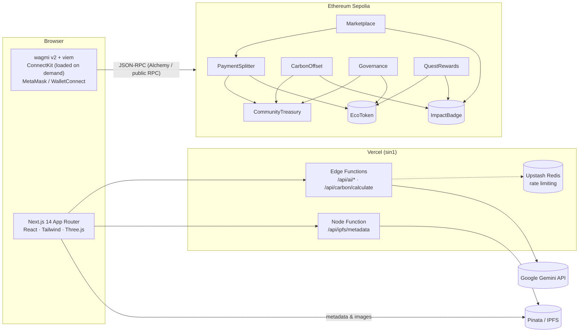
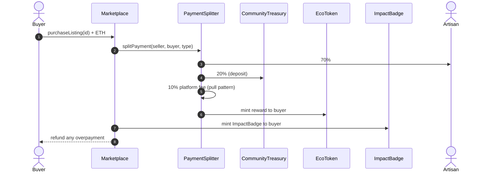

<div align="center">

# 🌿 MyHomeLab

### Regenerative Digital Eco-Tourism Platform

Web3, generative AI and a **direct-to-consumer** economy for sustainable, community-owned tourism in Vietnam.

[](https://github.com/ngthdanh05/HomeLab/actions/workflows/deploy.yml)
[](https://myhomelab.vercel.app)
[](https://sepolia.etherscan.io/address/0x92e554039D39014A5Fc55b31B1308f9DFe1098D5)
[](contracts/)
[](https://getfoundry.sh/)
[](frontend/)

**[Live demo](https://myhomelab.vercel.app)** · [Features](#-features) · [Architecture](#-architecture) · [Getting started](#-getting-started) · [Contracts](#-smart-contracts) · [Docs](#-documentation)

</div>

---

## 📖 Overview

Eco-tourism and cultural tourism face four recurring problems:

| Problem | What happens today |
| --- | --- |
| **Greenwashing** | "Green" labels with no independent, verifiable proof of the action behind them. |
| **Revenue leakage** | Online travel agencies take 15–30% commission; artisans and homestay owners are paid late and get the smallest share. |
| **No reinvestment loop** | Tourism profit rarely flows back, transparently, into conservation in the place that generated it. |
| **Fading heritage** | Intangible heritage and craft knowledge lack digital tools to be preserved and explained to visitors. |

**MyHomeLab** addresses them with smart contracts, AI and 3D web:

- **On-chain proof of action.** Purchases, carbon offsets and quests mint an `ImpactBadge` NFT whose metadata lives on IPFS, so green claims can be checked by anyone.
- **Instant direct-to-consumer payments.** `PaymentSplitter` splits every sale in the same transaction: **70% to the artisan, 20% to the Community Treasury, 10% platform fee**. No intermediary, no payment delay.
- **Circular rewards.** Buyers earn `EcoToken` (ECO, ERC-20), which is also voting power in the DAO.
- **Community DAO.** ECO holders propose and vote on conservation projects; passed proposals are paid out of the `CommunityTreasury` by the contract itself.
- **AI travel companion and digital heritage.** Google Gemini plans low-carbon itineraries and explains local etiquette; a Three.js viewer shows heritage sites in 360°.

---

## ✨ Features

| | Feature | Where |
| --- | --- | --- |
| 🧺 | **D2C Marketplace**: artisans list handicrafts, local food and tours (image + metadata pinned to IPFS); buyers pay in ETH and the split happens on-chain. | `/marketplace` |
| 🏅 | **Dashboard**: ECO balance, `ImpactBadge` gallery (flip cards) and an activity feed built from on-chain events. | `/dashboard` |
| 🌍 | **Carbon Tracker**: per-leg calculator (DEFRA 2023 factors) or free-text AI estimate; offset the trip on-chain and receive a `ZERO_CARBON` badge, with the fee paid to the Community Treasury. | `/carbon-tracker` |
| 🎯 | **Eco Quests**: 6 quests verified on-chain (purchases, offsets, DAO votes) that reward ECO and rare badges, claimable once per wallet. | `/quests` |
| 🗳️ | **Community DAO**: delegate voting power, create proposals, vote For/Against, execute after the deadline; the treasury balance and disbursement history are on the page. | `/governance` |
| 🤖 | **AI Travel Assistant**: streaming chat, itinerary planner and culture guide (dos & don'ts, phrases, customs), running on Vercel Edge Functions. | `/` |
| 🏛️ | **360° Digital Archive**: interactive equirectangular heritage scenes with hotspots (Three.js, loaded on demand). | `/` |

**Quality gates:** Lighthouse Accessibility and SEO score **100** on every page; Performance scores **90–98 on mobile** and **100 on desktop** ([report](docs/AUDIT_REPORT.md)). Every pull request runs contract, unit and end-to-end tests before it gets a preview deployment.

---

## 🏗 Architecture



### How a purchase flows



The DAO loop: ECO holders `delegate()` to themselves, then `propose` → `vote` (weighted by ECO at the snapshot block) → `execute`, which calls `CommunityTreasury.disburse()`. Diagrams for every flow (roles, DAO, AI request pipeline) are in [CLAUDE.md](CLAUDE.md).

---

## 📜 Smart Contracts

Solidity 0.8.24 on OpenZeppelin v5, built and tested with Foundry (`contracts/src/`).

| Contract | Standard / base | Responsibility |
| --- | --- | --- |
| `EcoToken` | ERC-20 · Capped (100M) · Burnable · Permit · **Votes** · AccessControl | Reward token and DAO voting power (holders must `delegate()` to vote). |
| `ImpactBadge` | ERC-721 · URIStorage · AccessControl | Proof-of-action NFTs: `ECO_CHECKIN`, `ZERO_CARBON`, `CULTURE_GUARDIAN`, `COMMUNITY_DONOR`. |
| `PaymentSplitter` | Ownable · ReentrancyGuard | 70 / 20 / 10 split in basis points, ECO rewards, pull-pattern platform fees. |
| `Marketplace` | Ownable · ReentrancyGuard | Create, buy and cancel D2C listings; refunds overpayment; mints the buyer's badge. |
| `CommunityTreasury` | Ownable · ReentrancyGuard | Holds community ETH; **only `Governance`** can `disburse()`; keeps an on-chain disbursement log. |
| `Governance` | Ownable · ReentrancyGuard | Proposals, snapshot voting (`block.number - 1`, flash-loan resistant), quorum, execution. |
| `CarbonOffset` | Ownable · ReentrancyGuard | Per-kg CO₂ offset fee sent to the treasury, mints `ZERO_CARBON`. |
| `QuestRewards` | Ownable · ReentrancyGuard | Verifies quest conditions on-chain (badges, offsets, DAO votes) and pays ECO + badges once per wallet. |

### Sepolia deployments (chain ID `11155111`)

| Contract | Address |
| --- | --- |
| EcoToken | [`0xacB3267dBBeA4924cEE9e5631618DB8342f39a24`](https://sepolia.etherscan.io/address/0xacB3267dBBeA4924cEE9e5631618DB8342f39a24) |
| ImpactBadge | [`0xba5404682DB9feb35fBB1cbC18b97f1A59b7a9C9`](https://sepolia.etherscan.io/address/0xba5404682DB9feb35fBB1cbC18b97f1A59b7a9C9) |
| CommunityTreasury | [`0x10E83c02C8667485EDd78ce57E0f6553D33296e6`](https://sepolia.etherscan.io/address/0x10E83c02C8667485EDd78ce57E0f6553D33296e6) |
| Governance | [`0x1e0404A2EDC3BB2139A82d2e8372631A11697998`](https://sepolia.etherscan.io/address/0x1e0404A2EDC3BB2139A82d2e8372631A11697998) |
| PaymentSplitter | [`0x5d574343A7e162Be9f3eA9Da676169d7Df874a66`](https://sepolia.etherscan.io/address/0x5d574343A7e162Be9f3eA9Da676169d7Df874a66) |
| Marketplace | [`0x92e554039D39014A5Fc55b31B1308f9DFe1098D5`](https://sepolia.etherscan.io/address/0x92e554039D39014A5Fc55b31B1308f9DFe1098D5) |
| CarbonOffset | [`0x4d51Ea6E0ACeBeBa0b96a72655B10457d769DFF5`](https://sepolia.etherscan.io/address/0x4d51Ea6E0ACeBeBa0b96a72655B10457d769DFF5) |
| QuestRewards | [`0x562845c0bd4F75e1d90207357A57f8aFA8f06F05`](https://sepolia.etherscan.io/address/0x562845c0bd4F75e1d90207357A57f8aFA8f06F05) |

All contracts are verified on Etherscan. Deployment history, roles and parameters are in [docs/DEPLOYMENTS.md](docs/DEPLOYMENTS.md).

---

## 🧰 Tech Stack

| Layer | Technologies |
| --- | --- |
| Smart contracts | Solidity 0.8.24, OpenZeppelin v5, Foundry (forge, cast, anvil), via-IR optimizer |
| Frontend | Next.js 14 (App Router), React 18, TypeScript, Tailwind CSS, Three.js |
| Web3 | wagmi v2, viem, ConnectKit (lazy-loaded), TanStack Query |
| AI | Google Gemini (`@google/generative-ai`) on Vercel Edge Functions, SSE streaming |
| Storage | IPFS via Pinata (server-side JWT), Upstash Redis for rate limiting (optional) |
| Testing | Foundry tests (unit, fuzz, integration), Node test runner, Playwright + Anvil |
| CI/CD | GitHub Actions → Vercel (`vercel deploy --prebuilt`), preview deployment per PR |

---

## 📁 Repository Structure

```
HomeLab/
├── contracts/                 # Foundry project
│   ├── src/                   # 8 contracts + interfaces/
│   ├── script/                # Deploy.s.sol, DeployCarbonOffset, DeployQuestRewards, QuestSetup
│   ├── test/                  # forge tests (unit, fuzz, integration)
│   ├── deployments/           # local.json / sepolia.json written by the deploy script
│   └── Makefile               # build, test, deploy-local, deploy-sepolia, simulate-e2e, …
├── frontend/                  # Next.js app
│   ├── src/app/               # pages + API routes (ai/*, carbon/calculate, ipfs/metadata)
│   ├── src/components/        # marketplace, dashboard, carbon, quests, governance, ai, archive
│   ├── src/hooks/             # wagmi/viem hooks per feature
│   ├── src/lib/               # framework-free logic (unit-tested)
│   ├── src/config/            # contract addresses + ABIs per chain, wagmi config
│   ├── test/                  # unit tests (node --test)
│   └── e2e/                   # Playwright suite running against Anvil
├── .github/workflows/         # ci.yml (tests) · deploy.yml (tests → Vercel)
└── docs/                      # plan, deployments, audit report, project status
```

---

## 🚀 Getting Started

### Prerequisites

- [Git](https://git-scm.com/) (on Windows, Git Bash for the shell scripts)
- [Foundry](https://getfoundry.sh/): `forge`, `cast`, `anvil`
- [Node.js](https://nodejs.org/) 22 and npm 11 (the lockfile is written by npm 11)
- [MetaMask](https://metamask.io/) for manual testing

### 1. Clone

```bash
git clone --recurse-submodules https://github.com/ngthdanh05/HomeLab.git
```

```bash
cd HomeLab/frontend && npm ci
```

### 2. Build and test the contracts

```bash
cd contracts && forge build && forge test
```

### 3. Run a local chain and deploy

Start Anvil in its own terminal and keep it running (the app expects port **8545**):

```bash
anvil --chain-id 31337
```

Deploy all eight contracts with the dev account #0 (addresses are deterministic and match `frontend/src/config/contracts.ts`):

```bash
cd contracts && make deploy-local
```

### 4. Configure and run the frontend

```bash
cd frontend && cp .env.example .env.local
```

Minimum settings for local development:

```dotenv
NEXT_PUBLIC_CHAIN_ID=31337        # 11155111 to use Sepolia
GEMINI_API_KEY=                   # https://aistudio.google.com/ (AI routes return 503 without it)
NEXT_PUBLIC_WALLETCONNECT_PROJECT_ID=   # optional; MetaMask works without it
PINATA_JWT=                       # optional; needed to upload listing images
```

The full list of variables (RPC, IPFS gateway, site URL, Redis) is documented in [`frontend/.env.example`](frontend/.env.example).

```bash
cd frontend && npm run dev
```

Open http://localhost:3000. In MetaMask, add the network `http://127.0.0.1:8545` (chain ID 31337) and import one of Anvil's dev accounts. To end a DAO voting period early on Anvil:

```bash
cast rpc evm_increaseTime 3601 && cast rpc evm_mine
```

---

## 🧪 Testing

| Suite | Command | Status |
| --- | --- | --- |
| Smart contracts (unit, fuzz, integration) | `cd contracts && forge test` | 183 tests |
| Frontend unit tests | `cd frontend && npm test` | 126 tests |
| Type check & lint | `cd frontend && npm run typecheck && npx eslint src test e2e` | clean |
| End-to-end (Playwright + Anvil) | `cd frontend && npm run e2e` | 9 tests, 5 user journeys |

The E2E suite starts a fresh Anvil chain, deploys with the real `Deploy.s.sol`, drives the app with a mock MetaMask wallet and reverts the chain between tests. It covers wallet connection, a marketplace purchase, a carbon offset, the full DAO flow (delegate → propose → vote → time travel → execute) and the dashboard. It also writes a V8 coverage report of `src/`. Stop your own Anvil first, because the suite needs port 8545. Details: [frontend/e2e/README.md](frontend/e2e/README.md).

---

## ☁️ Deployment

**Contracts (Sepolia):** put `PRIVATE_KEY`, `SEPOLIA_RPC_URL` and `ETHERSCAN_API_KEY` in `contracts/.env`, then run:

```bash
cd contracts && make deploy-sepolia
```

**Frontend (Vercel):** `.github/workflows/deploy.yml` runs every test suite first, then:

- **push to `main`** → production deploy to [myhomelab.vercel.app](https://myhomelab.vercel.app), plus a smoke test on the public domain;
- **pull request** → preview deploy, with the preview URL commented on the PR.

Vercel's own Git deployments are disabled, so nothing reaches production without passing CI. One-time setup (Vercel project, environment variables, GitHub secrets) is described in [docs/DEPLOYMENTS.md](docs/DEPLOYMENTS.md#-4-frontend-trên-vercel-task-54).

---

## 🔐 Security

- **Contracts:** Checks-Effects-Interactions, `nonReentrant` on every ETH transfer, custom errors, role-based minting (`MINTER_ROLE`), pull payments for platform fees, treasury withdrawals restricted to `Governance`, snapshot voting against flash loans. Fuzz and reentrancy tests are in `contracts/test/`.
- **Web app:** Content-Security-Policy, HSTS, `X-Frame-Options: DENY` and COOP headers; API keys (Gemini, Pinata) stay on the server; all AI input is validated and sanitised against prompt injection, and model output is normalised before it reaches the client; AI and upload routes are rate-limited.
- The contracts have **not** had an external audit. This is a testnet project; do not use it with real funds.

---

## 🗺 Roadmap

- [x] Phase 1: core smart contracts and revenue splitting
- [x] Phase 2: local and Sepolia deployment, Etherscan verification
- [x] Phase 3: Gemini AI engine, culture guide, 360° digital archive
- [x] Phase 4: marketplace, dashboard, carbon tracker, eco quests
- [x] Phase 5: DAO UI, Playwright E2E + CI, Lighthouse audit, Vercel production
- [ ] Run a DAO proposal end to end on Sepolia (the proposal threshold has to be lowered first)
- [ ] Server-side on-chain reads to bring mobile LCP under 2.5 s on data-heavy pages
- [ ] Dedicated IPFS gateway and image resizing in production

The detailed plan with definitions of done is in [docs/PLAN.md](docs/PLAN.md).

---

## 📚 Documentation

| Document | Contents |
| --- | --- |
| [CLAUDE.md](CLAUDE.md) | Developer guide: architecture diagrams, AI data flow, A–Z local setup |
| [docs/PLAN.md](docs/PLAN.md) | Phase-by-phase plan and definitions of done |
| [docs/DEPLOYMENTS.md](docs/DEPLOYMENTS.md) | Contract addresses, roles, Sepolia and Vercel deployment |
| [docs/AUDIT_REPORT.md](docs/AUDIT_REPORT.md) | Lighthouse performance, accessibility and SEO audit |
| [docs/DESCRIPTION.md](docs/DESCRIPTION.md) | Project status and change log |
| [frontend/e2e/README.md](frontend/e2e/README.md) | How the E2E test harness works |

Most documents in `docs/` are written in Vietnamese.

---

## 🤝 Contributing

1. Fork the repository and create a branch from `main`.
2. Make your change, adding tests (`contracts/test/`, `frontend/test/` or `frontend/e2e/`).
3. Run the checks from [Testing](#-testing) locally.
4. Open a pull request. CI runs every suite and posts a preview deployment URL.

---

## 📄 License

The smart contracts are released under the MIT license (SPDX headers in `contracts/src/`). A repository-wide `LICENSE` file has not been added yet.
