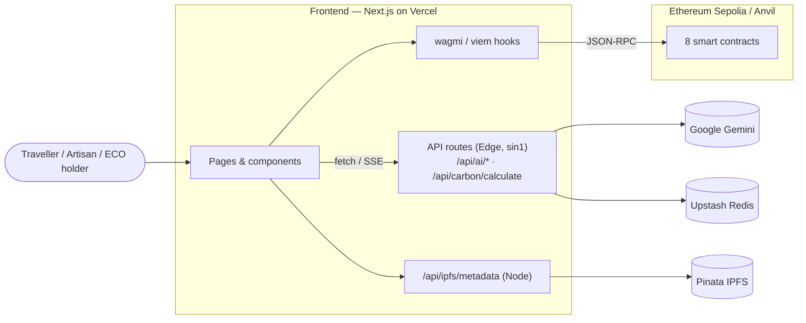
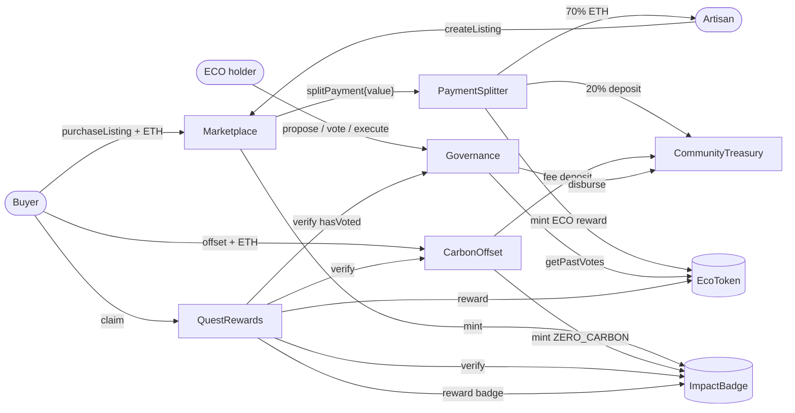

<div align="center">

# 🌿 MyHomeLab

**A regenerative digital eco-tourism platform built on Web3, Generative AI and a Direct-to-Consumer economy.**

Transparent proof of green actions, instant revenue sharing for local artisans, and a community DAO that reinvests tourism income into conservation.

[](https://github.com/ngthdanh05/HomeLab/actions/workflows/deploy.yml)


[**Live demo**](https://myhomelab.vercel.app) · [Deployments](docs/DEPLOYMENTS.md) · [Lighthouse audit](docs/AUDIT_REPORT.md) · [Project plan](docs/PLAN.md)

</div>

---

## Table of Contents

- [About the Project](#about-the-project)
- [Key Features](#key-features)
- [Tech Stack](#tech-stack)
- [Architecture](#architecture)
- [Smart Contracts](#smart-contracts)
- [Deployed Contracts](#deployed-contracts)
- [Getting Started](#getting-started)
- [Environment Variables](#environment-variables)
- [Testing](#testing)
- [Deployment](#deployment)
- [Project Structure](#project-structure)
- [Security](#security)
- [Contributing](#contributing)
- [License](#license)

---

## About the Project

### The problem

- **Greenwashing.** Many operators label themselves "eco" or "sustainable" without any independent, verifiable evidence.
- **Revenue leakage to intermediaries.** Online travel agencies take 15–30% commission, while the artisans and homestay owners who actually preserve local culture and landscapes receive a small share — often late.
- **No reinvestment mechanism.** Tourism profits are rarely set aside automatically and transparently to fund conservation or community projects at the destination.
- **Fading cultural heritage.** Intangible heritage, traditional knowledge and crafts lack modern digital tools for preservation and responsible visitor guidance.

### The solution

MyHomeLab combines **smart contracts**, **Google Gemini** and **3D web (Three.js)**:

| Pillar | How it works |
| --- | --- |
| **Proof of Action** | Every green action (eco check-in, carbon offset, donation) mints an `ImpactBadge` NFT with metadata stored on IPFS. |
| **D2C instant payments** | `PaymentSplitter` splits every purchase on-chain: **70%** to the artisan, **20%** to the community treasury, **10%** platform fee. |
| **Circular rewards** | Buyers and quest completers earn `EcoToken` (ECO), usable as DAO voting power. |
| **Community DAO** | ECO holders propose and vote on grants; approved proposals are paid out from `CommunityTreasury` automatically. |
| **AI & heritage** | Gemini plans low-carbon itineraries, estimates trip CO₂ and gives cultural etiquette guides; a 360° archive showcases digitised heritage. |

---

## Key Features

- 🛒 **D2C Marketplace** — artisans list handicrafts, food and experiences; travellers pay in ETH with automatic revenue splitting and excess refunds.
- 🏅 **Impact Badges** — ERC-721 badges: `ECO_CHECKIN`, `ZERO_CARBON`, `CULTURE_GUARDIAN`, `COMMUNITY_DONOR`.
- 🌍 **Carbon Tracker** — AI-assisted CO₂ estimation per trip leg, on-chain offset paid into the treasury, rewarded with a `ZERO_CARBON` badge.
- 🎯 **Eco Quests** — on-chain verified quests (badges owned, offsets made, DAO votes cast) that pay ECO and rare badges, once per wallet.
- 🗳️ **DAO Governance** — snapshot-based voting (flash-loan resistant), configurable threshold, quorum and voting period.
- 🤖 **AI Travel Assistant** — streaming chat, structured itinerary planner and culture guide powered by Gemini on the Edge runtime.
- 🏛️ **360° Digital Archive** — interactive equirectangular heritage scenes with hotspots (Three.js).
- 📊 **Dashboard** — ECO balance, badge gallery and on-chain activity feed.

**App routes:** `/` · `/marketplace` · `/marketplace/[listingId]` · `/carbon-tracker` · `/quests` · `/governance` · `/governance/[proposalId]` · `/dashboard`

---

## Tech Stack

| Layer | Technologies |
| --- | --- |
| **Smart contracts** | Solidity 0.8.24, OpenZeppelin Contracts, Foundry (`forge`, `cast`, `anvil`), `via_ir` + optimizer |
| **Frontend** | Next.js 14 (App Router), React 18, TypeScript, Tailwind CSS, Three.js |
| **Web3** | wagmi v2, viem, ConnectKit, TanStack Query, MetaMask / WalletConnect |
| **AI** | Google Gemini (`@google/generative-ai`) on Vercel Edge Functions |
| **Storage & infra** | IPFS via Pinata, Upstash Redis (rate limiting), Vercel (`sin1`) |
| **Quality** | Forge tests, Node test runner, ESLint, Playwright E2E on Anvil, GitHub Actions |

---

## Architecture



### Contract interactions



### Purchase flow

1. The traveller calls `Marketplace.purchaseListing(id)` with ETH.
2. `Marketplace` forwards the price to `PaymentSplitter.splitPayment(seller, buyer, type)` and refunds any excess.
3. `PaymentSplitter` sends 70% to the artisan, deposits 20% into `CommunityTreasury`, keeps 10% for the platform (pull pattern) and mints ECO to the buyer (100 ECO per 1 ETH).
4. `Marketplace` mints an `ImpactBadge` to the buyer based on the product type.
5. ECO holders `delegate`, then `propose` grants; after the voting period, `execute` pays the recipient from the treasury if quorum and majority are reached.
---

## Smart Contracts

All contracts live in [`contracts/src/`](contracts/src).

| Contract | Standards | Responsibility |
| --- | --- | --- |
| [`EcoToken`](contracts/src/EcoToken.sol) | ERC-20, Capped, Burnable, Permit, Votes, AccessControl | Reward token, capped at 100M ECO; voting power for the DAO. Only `MINTER_ROLE` can mint. |
| [`ImpactBadge`](contracts/src/ImpactBadge.sol) | ERC-721, URIStorage, AccessControl | Proof-of-Action NFT with IPFS metadata; `getBadgesByOwner` lookup. |
| [`PaymentSplitter`](contracts/src/PaymentSplitter.sol) | Ownable, ReentrancyGuard | Basis-point revenue split (70/20/10), ECO rewards, pull-based platform fee withdrawal. |
| [`Marketplace`](contracts/src/Marketplace.sol) | Ownable, ReentrancyGuard | Create, buy and cancel listings (`Handicraft`, `Food`, `Experience`). |
| [`CommunityTreasury`](contracts/src/CommunityTreasury.sol) | Ownable, ReentrancyGuard | Holds community ETH; only `Governance` may call `disburse()`; on-chain disbursement history. |
| [`Governance`](contracts/src/Governance.sol) | Ownable, ReentrancyGuard | Proposals with snapshot at `block.number - 1`, quorum in BPS, bounded voting period. |
| [`CarbonOffset`](contracts/src/CarbonOffset.sol) | Ownable, ReentrancyGuard | Pay per kg of CO₂ into the treasury and receive a `ZERO_CARBON` badge. |
| [`QuestRewards`](contracts/src/QuestRewards.sol) | Ownable, ReentrancyGuard | Verifies quest requirements on-chain and rewards ECO and badges. |

### Network parameters

| Parameter | Anvil (31337) | Sepolia (11155111) |
| --- | --- | --- |
| Revenue split (artisan / treasury / platform) | 70% / 20% / 10% | 70% / 20% / 10% |
| ECO reward rate | 100 ECO per ETH | 100 ECO per ETH |
| Proposal threshold | 1 ECO | 100 ECO |
| Quorum | 1% | 4% (deployed with 5%, changed by the owner) |
| Voting period | 1 hour | 14 hours (deployed with 3 days, changed by the owner) |
| Carbon offset price | 0.00001 ETH / kg | 0.00001 ETH / kg |

---

## Deployed Contracts

### Sepolia testnet (`11155111`)

| Contract | Address |
| --- | --- |
| EcoToken | [`0xacB3267dBBeA4924cEE9e5631618DB8342f39a24`](https://sepolia.etherscan.io/address/0xacB3267dBBeA4924cEE9e5631618DB8342f39a24) |
| ImpactBadge | [`0xba5404682DB9feb35fBB1cbC18b97f1A59b7a9C9`](https://sepolia.etherscan.io/address/0xba5404682DB9feb35fBB1cbC18b97f1A59b7a9C9) |
| CommunityTreasury | [`0x10E83c02C8667485EDd78ce57E0f6553D33296e6`](https://sepolia.etherscan.io/address/0x10E83c02C8667485EDd78ce57E0f6553D33296e6) |
| Governance | [`0x1e0404A2EDC3BB2139A82d2e8372631A11697998`](https://sepolia.etherscan.io/address/0x1e0404A2EDC3BB2139A82d2e8372631A11697998) |
| PaymentSplitter | [`0x5d574343A7e162Be9f3eA9Da676169d7Df874a66`](https://sepolia.etherscan.io/address/0x5d574343A7e162Be9f3eA9Da676169d7Df874a66) |
| Marketplace | [`0x92e554039D39014A5Fc55b31B1308f9DFe1098D5`](https://sepolia.etherscan.io/address/0x92e554039D39014A5Fc55b31B1308f9DFe1098D5) |
| CarbonOffset | [`0x4d51Ea6E0ACeBeBa0b96a72655B10457d769DFF5`](https://sepolia.etherscan.io/address/0x4d51Ea6E0ACeBeBa0b96a72655B10457d769DFF5) |
| QuestRewards | [`0x562845c0bd4F75e1d90207357A57f8aFA8f06F05`](https://sepolia.etherscan.io/address/0x562845c0bd4F75e1d90207357A57f8aFA8f06F05) |

Local Anvil addresses are deterministic (deployer = Anvil account #0) and listed in [docs/DEPLOYMENTS.md](docs/DEPLOYMENTS.md) together with redeployment notes.

---

## Getting Started

### Prerequisites

- [Git](https://git-scm.com/) (on Windows, use **Git Bash** for the `*.sh` scripts)
- [Foundry](https://getfoundry.sh/) — `forge`, `cast`, `anvil` on your `PATH`
- [Node.js](https://nodejs.org/) 20+ and npm
- GNU Make (optional — you can run the underlying `forge script` commands directly)
- [MetaMask](https://metamask.io/) for manual testing
- A [Gemini API key](https://aistudio.google.com/) for the AI features

### 1. Clone and install

```bash
git clone --recurse-submodules https://github.com/ngthdanh05/HomeLab.git
```

```bash
cd HomeLab/frontend && npm ci
```

If you cloned without submodules, run `git submodule update --init --recursive` to fetch OpenZeppelin and forge-std.

### 2. Build and test the contracts

```bash
cd contracts && forge build && forge test
```

### 3. Start a local chain

In a separate terminal (keep it running; port **8545** must be free):

```bash
anvil --chain-id 31337
```

### 4. Deploy to Anvil

```bash
cd contracts && make deploy-local
```

This deploys all eight contracts, grants minter roles, wires the treasury to governance, loads six default quests and writes `contracts/deployments/local.json`. The addresses match those hard-coded in [`frontend/src/config/contracts.ts`](frontend/src/config/contracts.ts) as long as Anvil was freshly started.

Optionally, run a scripted end-to-end scenario with `cast` (create listing → purchase → check balances → propose → vote and execute):

```bash
cd contracts && make simulate-e2e
```

### 5. Configure the frontend

```bash
cd frontend && cp .env.example .env.local
```

Set at least `NEXT_PUBLIC_CHAIN_ID=31337` and `GEMINI_API_KEY`. See [Environment Variables](#environment-variables).

### 6. Run the app

```bash
cd frontend && npm run dev
```

Open <http://localhost:3000>.

### 7. Connect MetaMask to Anvil

1. Add a network with RPC `http://127.0.0.1:8545`, chain ID `31337`, currency `ETH`.
2. Import one of the dev private keys printed by `anvil`.
3. After restarting Anvil, clear MetaMask's activity data (*Settings → Advanced*) to reset the nonce.
4. To vote, earn ECO first (e.g. buy a listing), then delegate to yourself. Skip the voting period locally with:

```bash
cast rpc evm_increaseTime 3601 && cast rpc evm_mine
```

### Updating ABIs

After changing a contract's interface, copy the Foundry artifacts into the frontend:

```bash
cd contracts && forge build && for c in EcoToken ImpactBadge CommunityTreasury Governance PaymentSplitter Marketplace CarbonOffset QuestRewards; do cp out/$c.sol/$c.json ../frontend/src/abis/$c.json; done
```

---

## Environment Variables

### Frontend (`frontend/.env.local`)

| Variable | Required | Description |
| --- | --- | --- |
| `NEXT_PUBLIC_CHAIN_ID` | yes | `31337` (Anvil) or `11155111` (Sepolia, default) |
| `GEMINI_API_KEY` | for AI | Server-only Gemini key; AI routes return 503 without it |
| `GEMINI_MODEL` | no | Gemini model name (defaults to `gemini-3.8-flash`) |
| `NEXT_PUBLIC_WALLETCONNECT_PROJECT_ID` | no | Enables WalletConnect; otherwise only injected wallets |
| `NEXT_PUBLIC_SEPOLIA_RPC_URL` | no | Preferred Sepolia RPC; public endpoints are used as fallback |
| `PINATA_JWT` | no | Server-only; enables IPFS uploads for listing metadata |
| `NEXT_PUBLIC_IPFS_GATEWAY` | no | Gateway used to display IPFS content |
| `NEXT_PUBLIC_SEPOLIA_CARBON_OFFSET_ADDRESS` | no | Overrides the Sepolia `CarbonOffset` address |
| `NEXT_PUBLIC_SEPOLIA_QUEST_REWARDS_ADDRESS` | no | Overrides the Sepolia `QuestRewards` address |
| `NEXT_PUBLIC_SITE_URL` | production | Canonical URL for OpenGraph and sitemap |
| `UPSTASH_REDIS_REST_URL` / `UPSTASH_REDIS_REST_TOKEN` | production | Shared rate limiting across serverless instances (in-memory fallback otherwise) |

### Contracts (`contracts/.env`, Sepolia only)

| Variable | Description |
| --- | --- |
| `PRIVATE_KEY` | Deployer key (never commit) |
| `SEPOLIA_RPC_URL` | Sepolia RPC endpoint |
| `ETHERSCAN_API_KEY` | Source verification |
| `*_ADDRESS` | Existing addresses, used to resume a partial deployment |
| `CARBON_PRICE_PER_KG_WEI` | Optional carbon offset price |

---

## Testing

| Suite | Command |
| --- | --- |
| Contract unit & integration tests | `cd contracts && forge test -vvv` |
| Contract coverage | `cd contracts && forge coverage` |
| Frontend type check | `cd frontend && npm run typecheck` |
| Frontend lint | `cd frontend && npx eslint src test e2e` |
| Frontend unit tests | `cd frontend && npm test` |
| End-to-end (Playwright + Anvil) | `cd frontend && npx playwright install chromium && npm run e2e` |

The E2E suite starts its own Anvil, deploys with the real `Deploy.s.sol`, seeds test data and drives a mock MetaMask wallet through wallet connection, purchases, carbon offsets, governance voting and the dashboard. Stop any Anvil you are running first. Details: [frontend/e2e/README.md](frontend/e2e/README.md).

All of the above run in CI ([`.github/workflows/ci.yml`](.github/workflows/ci.yml)), called by the deploy workflow on every pull request and push to `main`.

---

## Deployment

### Contracts → Sepolia

```bash
cd contracts && cp .env.example .env
```

| Command | Purpose |
| --- | --- |
| `make simulate-sepolia` | Dry run without broadcasting |
| `make deploy-sepolia` | Full deployment with Etherscan verification |
| `make deploy-sepolia-resume` | Resume using addresses already set in `.env` |
| `make deploy-carbon-sepolia` | Deploy `CarbonOffset` only and grant its minter role |
| `make deploy-quests-sepolia` | Deploy `QuestRewards` only, load quests and grant roles |
| `make verify-sepolia` | Verify contracts on Etherscan |

After a redeployment, update `DEPLOYMENTS` and `LOGS_FROM_BLOCK` in [`frontend/src/config/contracts.ts`](frontend/src/config/contracts.ts) and record it in [docs/DEPLOYMENTS.md](docs/DEPLOYMENTS.md).

### Frontend → Vercel

Vercel's Git auto-deploy is disabled. Pushing to `main` triggers [`.github/workflows/deploy.yml`](.github/workflows/deploy.yml), which runs the full test suite and then deploys the prebuilt app to production at **<https://myhomelab.vercel.app>** (region `sin1`; Edge AI routes are pinned there because Gemini is unavailable from some edge locations).

---

## Project Structure

```
HomeLab/
├── contracts/                 # Foundry project
│   ├── src/                   # Solidity contracts + interfaces
│   ├── script/                # Deploy scripts, quest setup, cast interaction scripts
│   ├── test/                  # Forge tests and mocks
│   ├── deployments/           # Generated deployment addresses
│   └── Makefile               # Build, test and deploy targets
├── frontend/                  # Next.js application
│   ├── src/app/               # Pages and API routes (AI, carbon, IPFS)
│   ├── src/components/        # UI by feature (marketplace, governance, carbon, ai, archive...)
│   ├── src/hooks/             # Contract and AI hooks
│   ├── src/lib/               # Gemini client, validation, rate limiting, SSE, utils
│   ├── src/config/            # Contract addresses/ABIs, wagmi config
│   ├── src/abis/              # Contract ABIs (Foundry artifacts)
│   ├── test/                  # Unit tests (node --test)
│   └── e2e/                   # Playwright tests and Anvil fixtures
├── docs/                      # Plan, deployments, audit report, description
└── .github/workflows/         # CI and deploy pipelines
```

---

## Security

- Checks-Effects-Interactions and `ReentrancyGuard` on every ETH-moving function; custom errors throughout.
- Platform fees use a pull pattern (`withdrawPlatformFees`) to avoid DoS on payments.
- Governance snapshots voting power at `block.number - 1` to resist flash-loan vote manipulation; only `Governance` can disburse treasury funds.
- AI routes enforce rate limiting, a 16 KB body limit, input sanitisation, delimited user content against prompt injection, timeouts, and normalisation of model output.
- Strict security headers and Content-Security-Policy in [`frontend/next.config.mjs`](frontend/next.config.mjs).

The contracts are deployed on a **testnet only** and have **not** had a third-party security audit — do not use them with real funds. ([docs/AUDIT_REPORT.md](docs/AUDIT_REPORT.md) is a Lighthouse performance, accessibility and SEO audit of the frontend.)

---

## Contributing

1. Fork the repository and create a feature branch (`git checkout -b feat/my-feature`).
2. Make your changes with tests (`contracts/test/` for Solidity, `frontend/test/` or `frontend/e2e/` for the app).
3. Make sure `forge test`, `npm run typecheck`, `npx eslint src test e2e` and `npm test` pass.
4. Use [Conventional Commits](https://www.conventionalcommits.org/) (`feat:`, `fix:`, `docs:`, `ci:` …) and open a pull request against `main`.

---

## License

No license file has been added to this repository yet. The Solidity sources carry the `SPDX-License-Identifier: MIT` header.
