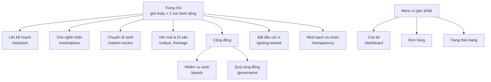

# UX-UI.md — Góp ý cải thiện giao diện MyHomeLab

Tài liệu này là bản đánh giá giao diện hiện tại và là kim chỉ nam khi làm lại UI.
Mỗi góp ý đều gắn với một màn hình hoặc một file cụ thể để có thể làm dần từng mục.

> **Phạm vi đánh giá (2026-11-10):** bản build local của nhánh `feat/security-escrow-sepolia-redeploy`, đọc dữ liệu Sepolia,
> xem ở 1280×800 và 375×812.
>
> **Chưa xem được trên màn hình thật:** các trạng thái **đã kết nối ví** (Dashboard có dữ liệu, bảng quyền biểu quyết),
> và **Marketplace có sản phẩm** (Sepolia hiện chưa có listing nào), **thẻ đề xuất DAO** (chưa có đề xuất nào).
> Góp ý cho các phần này dựa trên đọc code, nên cần xem lại khi có dữ liệu.

---

## 1. Vì sao website có cảm giác "hỗn độn"

Về kỹ thuật, trang đã tốt (Lighthouse Accessibility 100, có skeleton, xử lý lỗi giao dịch kỹ).
Vấn đề nằm ở chỗ **giao diện đang kể câu chuyện của người lập trình, không phải của du khách**. Có 6 nguyên nhân gốc:

| # | Nguyên nhân | Bằng chứng |
| --- | --- | --- |
| 1 | **Không có lối đi chính.** Khách vào trang không biết nên làm gì trước. | Trang chủ là 3 tab công cụ. Menu có 6 mục ngang hàng, không có nút hành động chính nào. |
| 2 | **Nhiều lớp điều hướng lồng nhau.** | Tab Văn hoá có 3 tầng: tab chính → chọn điểm đến → tab con. Tab AI có thêm nút chuyển "Lịch trình" bên trong khung chat, phải có một dòng gợi ý riêng để giải thích. |
| 3 | **Ngôn ngữ kỹ thuật đặt lên trước.** | H1 trang chủ có chữ "Three.js". Trang chủ khách du lịch hiển thị 6 địa chỉ contract. Người dùng gặp: `D2C`, `on-chain`, `escrow`, `Quorum`, `NFT`, `ZERO_CARBON`, `delegate`. |
| 4 | **Việt và Anh lẫn lộn.** | "Connect Wallet" cạnh "Khám phá"; "AI Travel Assistant", "Culture & Language", "Carbon offset lần đầu". Cùng một nút khi thì "Connect Wallet", khi thì "Kết nối ví". |
| 5 | **Không có design system.** Mỗi màn hình tự đặt style. | `components/ui/` chỉ có `Toast`. Class `bg-emerald-700` lặp 31 lần. 6 mức bo góc khác nhau. 31 chỗ dùng chữ 10–11px. Token `brand-*` trong Tailwind không được dùng lần nào. |
| 6 | **Mọi thứ đều "hét" cùng lúc.** | Emoji và ký tự biểu tượng làm icon ở 40 file, nền gradient, viền màu, badge viên thuốc, chữ mono màu sáng xuất hiện cùng nhau nên không còn thứ bậc thị giác. |

**Hướng sửa tổng quát:** một lối đi chính → ít lựa chọn hơn trên mỗi màn hình → ngôn ngữ của du khách → một bộ component dùng chung.
Blockchain vẫn còn đó, nhưng là **lớp minh bạch để ai muốn thì xem**, không phải thứ đầu tiên người dùng phải hiểu.

---

## 2. Quyết định cần chốt trước khi làm

| Quyết định | Khuyến nghị | Lý do |
| --- | --- | --- |
| **Giao diện sáng hay tối?** | **Sáng, tông biển: cát trắng – xanh đại dương – cam san hô** (đã chốt, lấy cảm hứng từ rạn san hô và làng chài). | Nền tối + xanh neon + chữ mono là phong cách sàn crypto. Du lịch sinh thái và thủ công cần cảm giác ấm, gần gũi, và ảnh sản phẩm lên màu tốt hơn trên nền sáng. Dark mode có thể thêm sau nhờ token ở mục 4. |
| **Ai là người dùng chính?** | **Du khách quan tâm du lịch bền vững, chưa biết về Web3.** Nghệ nhân là thứ hai, người giữ ECO là thứ ba. | Quyết định thứ tự ưu tiên của mọi màn hình bên dưới. |
| **Tên thương hiệu "MyHomeLab"?** | Nên đổi tên hiển thị. | Tên này gợi tới phòng lab server tại nhà, không liên quan đến du lịch. Có thể giữ tên repo. Nếu đổi, sửa `SITE_NAME` trong `frontend/src/lib/seo.ts`. |
| **Mua hàng thật giao thế nào?** | Cần chốt nghiệp vụ (xem 5.2). | Hiện luồng mua không thu địa chỉ hay liên hệ nào, người bán không biết giao cho ai. |

---

## 3. Cấu trúc thông tin và điều hướng

### 3.1 Sơ đồ đề xuất

### 3.2 Header — [SiteHeader.tsx](../frontend/src/components/layout/SiteHeader.tsx)

Đo được: ở 1280px header bị **rớt thành 2 hàng, cao 117px**. Trên điện thoại cao **141px và luôn dính đầu trang**, cộng banner testnet là 185px khi mới vào, tức 23% màn hình 812px.

- Logo + 4 mục menu + nút ví trên **một hàng duy nhất**, cao tối đa 64px.
- Bỏ dòng tagline dưới logo và ô "Sepolia Testnet" (đưa vào menu ví, banner đã nói về testnet).
- Bỏ emoji trong menu. Tên menu đề xuất: **Khám phá · Chợ nghệ nhân · Chuyến đi xanh · Cộng đồng ▾**.
- "Dashboard" chuyển vào menu ví, gọi là **Của tôi**.
- Mobile: dùng **thanh tab dưới đáy** (4–5 mục, cao ≥ 56px) hoặc menu hamburger. Hiện link menu cao 32px, dưới mức tối thiểu 44px cho ngón tay.

### 3.3 Link sâu cho mọi nội dung

Các tab trang chủ chỉ nằm trong `useState`, nên không chia sẻ được link và không quay lại đúng chỗ.
Hậu quả thực tế: nút của quest "Nhà thám hiểm di sản" đưa về trang chủ rồi phải tự tìm tab, nên nhãn nút mới phải là "Trang chủ → tab 360° Digital Archive".
Tách thành các route riêng sẽ giải quyết việc này, đồng thời tốt hơn cho SEO.

---

## 4. Design system

Mục tiêu: **sửa một chỗ, đổi toàn trang**. Các cặp chữ/nền dưới đây đã tính độ tương phản, đều đạt WCAG AA (≥ 4.5:1; viền ô nhập ≥ 3:1).

### 4.1 Màu

Khai báo CSS variables trong `globals.css`, ánh xạ vào `tailwind.config.js` theo **vai trò**, thay cho tên màu (`emerald-700`, `slate-400`…).

| Token | Giá trị | Dùng cho | Tương phản |
| --- | --- | --- | --- |
| `bg` | `#F7F9F9` | Nền trang (cát trắng bọt sóng) | |
| `surface` | `#FFFFFF` | Thẻ, modal | |
| `border` | `#DCE5E6` | Viền trang trí | |
| `border-strong` | `#788B8E` | Viền ô nhập liệu | 3.57 trên surface |
| `text` | `#132A33` | Chữ chính (xanh đen đáy biển) | 14.13 trên bg |
| `text-muted` | `#4D646D` | Chữ phụ | 5.92 trên bg · 6.25 trên surface |
| `primary` | `#0E6375` | Nút chính, link (xanh đại dương sâu) | 6.86 với chữ trắng |
| `primary-hover` | `#0A4D5C` | Hover nút chính | 9.42 với chữ trắng |
| `primary-soft` | `#E3F2F5` | Nền nhãn xanh | 5.98 với chữ `primary` |
| `accent` | `#C2513A` | Điểm nhấn, phần thưởng (cam san hô) | 4.63 với chữ trắng · 4.63 trên surface |
| `accent-strong` | `#B24B35` | **Chữ** trên `accent-soft` | 4.63 (chữ `accent` trên `accent-soft` chỉ 4.04, không đạt) |
| `accent-soft` | `#FCECE8` | Nền nhãn nhấn | |
| `warning` / `-soft` | `#7A4F00` / `#FBF0D9` | Cảnh báo | 6.30 |
| `danger` / `-soft` | `#A3221B` / `#FBE7E5` | Lỗi, hành động nguy hiểm | 6.30 |
| `info` / `-soft` | `#1B5A85` / `#E3EFF7` | Thông tin | 6.31 |

Giá trị khai báo dạng kênh RGB (`--color-primary: 14 99 117`) nên dùng được độ mờ của Tailwind (`border-primary/30`).
`tailwind.config.js` **thay hẳn** bảng màu mặc định: class `slate-*`, `emerald-*`… không còn tạo ra style.
Test `frontend/test/design-system.test.mjs` chặn màu thô, chữ < 12px, bo góc ngoài 3 mức, bước 2px và emoji.

Quy tắc:

- **Xanh đại dương là màu duy nhất của hành động.** Mỗi màn hình tối đa một nút `primary`.
- Hiện mỗi trang một màu hero (xanh, xanh dương, hổ phách) nhưng không theo logic nào, Carbon và DAO còn trùng màu. Bỏ màu theo trang.
- ~~Xoá `brand.blue/cyan/violet` và cặp biến `--background` / `--foreground`~~ (đã xoá; `<body>` dùng `bg-bg text-text`).

### 4.2 Chữ

**Lỗi đang thấy:** Tailwind khai báo font `Inter`, nhưng dự án không hề tải font này, nên phần lớn máy sẽ rơi về Arial.
Tiêu đề `font-extrabold` hiện bị **vỡ dấu tiếng Việt**: các chữ như "Tuần", "quyết", "Quỹ" có dấu khác kiểu với thân chữ. Xem rõ nhất trên H1 các trang.

- Dùng **Be Vietnam Pro** qua `next/font/google` với `subsets: ["vietnamese", "latin"]`. Font được tự host nên không phải sửa CSP.
- Thang cỡ chữ cố định, **không dưới 12px**, bỏ toàn bộ `text-[10px]` và `text-[11px]`:

| Vai trò | Cỡ | Đậm |
| --- | --- | --- |
| Tiêu đề trang | 32–40px | 700 |
| Tiêu đề mục | 24px | 600 |
| Tiêu đề thẻ | 18px | 600 |
| Nội dung | 16px | 400 |
| Phụ | 14px | 400 |
| Chú thích | 12–13px | 500 |

- Chữ mono **chỉ dùng cho địa chỉ ví và mã giao dịch**. Giá và số liệu dùng font thường với `tabular-nums`.

### 4.3 Khoảng cách, bo góc, đổ bóng

- Khoảng cách theo bậc 4px: 8 · 12 · 16 · 24 · 32 · 48 · 64. Khoảng cách giữa các khối lớn ≥ 48px trên desktop.
- Giảm 6 mức bo góc còn 3: `8px` (ô nhập, nhãn) · `12px` (nút, thẻ nhỏ) · `20px` (thẻ lớn, modal).
- Thẻ trên nền sáng dùng viền mảnh hoặc bóng nhẹ, không dùng cả hai. Bỏ `shadow-emerald-*` và gradient trong thẻ.

### 4.4 Icon và hình ảnh

- Thay emoji bằng **một bộ icon nét** (khuyến nghị `lucide-react`). Emoji hiển thị khác nhau theo hệ điều hành và làm giao diện trẻ con. Chỉ giữ emoji ở khoảnh khắc ăn mừng.
- **Ảnh thật là thứ tạo cảm giác du lịch nhiều nhất**: làng nghề, chân dung nghệ nhân, phong cảnh. Hiện không có ảnh nào: hero chỉ có gradient, thẻ di sản 360° chỉ có một emoji và dòng `[Chạm để mở không gian 360°]`.

### 4.5 Component dùng chung (`frontend/src/components/ui/`)

| Component | Thay cho |
| --- | --- |
| `Button` (primary, secondary, ghost, danger; size md, lg; `loading`) | 31 lần lặp `bg-emerald-700 …` |
| `TxButton` | Logic nhãn "Xác nhận trong ví… / Đang chờ…" đang chép ở `PurchaseButton`, `QuestCard`, `VotingPowerPanel`, `CarbonOffsetButton`, `CreateListingModal` |
| `Card`, `PageHeader`, `Stat` | Hero và thẻ tự viết ở mỗi trang |
| `Tabs` / `FilterChips` | 3 kiểu lọc khác nhau ở Marketplace, DAO, Di sản |
| `Field` (label, hint, error) + `Input`, `Select` | Ô nhập mỗi nơi một kiểu. Trang Carbon: select cao 34px cạnh input cao 37px, lệch hàng |
| `Modal` | Modal tự viết, **chưa giữ focus bên trong** khi dùng bàn phím |
| `Alert`, `EmptyState`, `Skeleton` | Ít nhất 3 biến thể khung lỗi màu đỏ khác nhau |
| `Address` (rút gọn, sao chép, link Etherscan), `Amount` | Hiển thị ví và giá không thống nhất |
| `ConfirmDialog` | Hành động không đảo ngược (giải ngân, khiếu nại, hoàn tiền, huỷ đăng bán) chạy ngay khi bấm |
| `ProgressSteps` | Trạng thái đơn hàng chỉ là một câu chữ |
| `Switch` | Lựa chọn bật/tắt trộn vào bộ lọc ("Tất cả (kể cả đã bán)") |

---

## 5. Góp ý theo từng trang

Mức ưu tiên: 🔴 lỗi hoặc cản trở trực tiếp · 🟡 cải thiện rõ rệt · 🟢 làm sau.

### 5.1 Trang chủ — [page.tsx](../frontend/src/app/page.tsx)

Đo được: ô nhập chat nằm ở **y = 1133px** trên desktop và **y = 1500px** trên điện thoại, tức người dùng phải cuộn mới dùng được tính năng chính.

| Mức | Vấn đề | Đề xuất |
| --- | --- | --- |
| 🔴 | H1 "…cùng AI & Three.js" nói về công nghệ. | Nói về lợi ích, ví dụ: **"Du lịch Việt Nam theo cách tử tế hơn"**. Phụ đề một câu. |
| 🔴 | Hai footer chồng nhau (một ở `page.tsx`, một ở `layout.tsx`), và dòng "Next.js 14" đã sai (dự án dùng 15.5). | Giữ một footer ở layout. Bỏ danh sách công nghệ. |
| 🔴 | Khối "On-chain Ecosystem Contracts" nằm trên trang chủ cho du khách. | Chuyển sang `/transparency`, footer có link "Minh bạch on-chain". |
| 🔴 | Ba tab công cụ thay cho một trang giới thiệu. | Làm landing page theo bố cục dưới, tách AI, Văn hoá, Di sản thành route riêng. |
| 🟡 | "Powered by Gemini" lặp lại, dòng gợi ý giải thích giao diện. | Bỏ. Giao diện cần tự rõ ràng. |
| 🟡 | Dữ liệu văn hoá có câu lỗi: "Không mặc cả khi đèn lồng trong phố cổ - gây ô nhiễm nước" (`data/culturalData.ts:33`). | Sửa nội dung, có lẽ ý là không thả đèn lồng xuống sông. Rà lại toàn bộ dữ liệu. |

**Bố cục trang chủ đề xuất:**

1. **Hero có ảnh thật:** một câu hứa, hai nút: **Lên kế hoạch chuyến đi** (chính) và **Mua từ nghệ nhân** (phụ).
2. **Ô hỏi nhanh AI** với 3–4 câu gợi ý, gửi xong chuyển sang `/assistant`.
3. **Cách hoạt động** (3 bước): Khám phá → Ủng hộ cộng đồng địa phương → Xem tác động của bạn.
4. **Sản phẩm nổi bật** từ nghệ nhân.
5. **Điểm đến và di sản**: thẻ ảnh Hội An, Sa Pa, Phú Quốc.
6. **Con số tác động**: tổng quỹ, số kg CO₂ đã bù đắp, số nghệ nhân. Đây là chỗ blockchain phát huy giá trị một cách dễ hiểu.

Trang Văn hoá nên gộp về **một tầng điều hướng**: chọn điểm đến, nội dung cuộn trên một trang với mục lục (Nên / Không nên, Ẩm thực, Ngôn ngữ, Hỏi AI).

### 5.2 Chợ nghệ nhân — [marketplace/page.tsx](../frontend/src/app/marketplace/page.tsx)

Đo được: hero cao 345px, thanh lọc bắt đầu ở y = 554px, hàng sản phẩm đầu tiên gần như nằm dưới màn hình đầu.

| Mức | Vấn đề | Đề xuất |
| --- | --- | --- |
| 🔴 | **Sepolia hiện 0 sản phẩm**, ấn tượng đầu tiên là một trang trống. | Tạo 8–12 sản phẩm demo có ảnh đẹp. |
| 🔴 | Lời mời "Hãy là nghệ nhân đầu tiên đăng bán!" nhưng chỉ ví đã xác thực mới đăng được. Người dùng chỉ biết điều này **sau khi điền xong form**. | Kiểm tra ví và xác thực ngay khi mở form. Nếu chưa đủ điều kiện thì hiện hướng dẫn đăng ký nghệ nhân thay cho form. Sửa nội dung trang trống. |
| 🔴 | Luồng mua không thu địa chỉ hay liên hệ, người bán không biết giao hàng cho ai. | Chốt nghiệp vụ. **Không ghi dữ liệu cá nhân lên chain**: lưu off-chain có mã hoá, hoặc chỉ hiển thị liên hệ của người bán sau khi mua. |
| 🔴 | Không có trang "Đơn hàng". Người mua phải quay lại đúng trang sản phẩm mới xác nhận nhận hàng được. | Thêm mục Đơn hàng trong Của tôi, nêu rõ đơn nào cần xử lý. Nghệ nhân có mục tương tự. |
| 🟡 | Nút lớn nhất là "Đăng bán", trong khi đa số khách vào để mua. | Hạ thành nút phụ hoặc link "Bạn là nghệ nhân?". |
| 🟡 | Bộ lọc trộn trạng thái với danh mục; "Tất cả (kể cả đã bán)" khó hiểu. | Danh mục: Tất cả · Thủ công · Đặc sản · Trải nghiệm. Công tắc riêng "Hiện sản phẩm đã bán". Thêm tìm kiếm và sắp xếp theo giá. |
| 🟡 | Khung chia 70/20/10 chiếm màn hình đầu. | Rút thành một dòng có link "Tiền của bạn đi về đâu?", để chi tiết ở trang sản phẩm. |
| 🟡 | Thẻ sản phẩm chỉ có địa chỉ `0x…` làm người bán, chữ 10–11px, ảnh cao 176px. | Tên nghệ nhân + làng nghề, ảnh tỉ lệ 4:3 lớn hơn, giá 18px. Thêm tên và địa phương vào metadata IPFS, không phải sửa contract. |
| 🟡 | Nhãn "Đã bán / Đã huỷ" gộp hai trạng thái. | Tách riêng, hoặc ẩn sản phẩm đã huỷ. |

**Trang chi tiết sản phẩm** — [\[listingId\]/page.tsx](../frontend/src/app/marketplace/[listingId]/page.tsx):

- Thứ tự cột phải: Tên → Giá → **Nút mua** → cam kết "Tiền được giữ an toàn tới khi bạn nhận hàng" → Mô tả → Câu chuyện nghệ nhân → Tiền đi về đâu. Hiện nút mua nằm sau cả khối thông tin và khối chia tiền.
- Mobile: thanh **giá + nút mua dính dưới đáy**.
- Địa chỉ ví đầy đủ chuyển thành link "Xem trên Etherscan" trong mục chi tiết giao dịch.
- Trạng thái đơn hiển thị dạng **dòng tiến trình**: Đã thanh toán → Đã nhận hàng → Hoàn tất, kèm hạn tự động giải ngân. Bước "Đang giao" chỉ thêm được nếu contract hoặc hệ thống off-chain ghi nhận việc giao hàng.
- 🔴 `Đã nhận hàng, giải ngân`, `Khiếu nại`, `Hoàn tiền` là hành động không đảo ngược nhưng chạy ngay khi bấm: cần hộp thoại xác nhận nêu rõ hậu quả.
- Sau khi mua, ngoài toast cần màn hình "Tiếp theo là gì?".

### 5.3 Chuyến đi xanh — [carbon-tracker/page.tsx](../frontend/src/app/carbon-tracker/page.tsx)

Đây là trang có bố cục tốt nhất, chỉ cần tinh chỉnh.

| Mức | Vấn đề | Đề xuất |
| --- | --- | --- |
| 🔴 | Trang tự điền sẵn 630 km máy bay rồi ghi "Chuyến đi **của bạn** phát thải 155,8 kg" dù người dùng chưa nhập gì. | Bắt đầu trống, hoặc gắn nhãn rõ "Ví dụ: TP.HCM – Hội An". |
| 🔴 | Câu "chưa phải tín chỉ carbon đã được kiểm định" nằm ở chữ 11px, trong khi hero viết "không tẩy xanh". | Đưa thông tin này lên chữ thường cạnh nút. Tính minh bạch là giá trị cốt lõi của trang. |
| 🟡 | Chưa kết nối ví thì nút chỉ ghi "Kết nối ví để bù đắp", không thấy phí. | Hiện phí trước: "Bù đắp 155,8 kg · 0,00156 ETH thử nghiệm". Phí đọc được mà không cần ví. |
| 🟡 | Mục "Tóm tắt bù đắp" lặp số liệu đã có ở khối kết quả. | Gộp vào khối kết quả. |
| 🟡 | Luồng chưa rõ ràng. | Đánh số 3 bước: **1. Tính → 2. Giảm → 3. Bù đắp**. |
| 🟢 | 155,8 kg khó hình dung. | So sánh dễ hiểu có nguồn dẫn, ví dụ quy đổi ra quãng đường ô tô. |

### 5.4 Nhiệm vụ xanh — [quests/page.tsx](../frontend/src/app/quests/page.tsx)

| Mức | Vấn đề | Đề xuất |
| --- | --- | --- |
| 🔴 | Quest "Tiếng nói cộng đồng" yêu cầu bỏ phiếu nhưng nút ghi **"Xem số dư ECO"** và dẫn tới `/dashboard` (`data/quests.ts:96`). | Đổi thành "Tới Quỹ cộng đồng", link `/governance`. |
| 🔴 | Trên Sepolia hiện **3/6 quest không thể làm**: chưa có sản phẩm để mua (2 quest), chưa có đề xuất để bỏ phiếu (1 quest). | Seed dữ liệu, và hiện trạng thái "Chưa có đề xuất nào, quay lại sau". |
| 🟡 | Chưa nói ECO để làm gì. | Một dòng giải thích: ECO là quyền biểu quyết về cách dùng Quỹ. |
| 🟡 | 6 thẻ ngang hàng, không biết nên làm gì trước. | Sắp theo hành trình, làm nổi bật **"Nhiệm vụ tiếp theo"**. |
| 🟡 | Khối "Kết nối ví" to giữa trang đẩy danh sách xuống. | Một dải mỏng ngay dưới tiêu đề. |

### 5.5 Quỹ cộng đồng — [governance/page.tsx](../frontend/src/app/governance/page.tsx)

| Mức | Vấn đề | Đề xuất |
| --- | --- | --- |
| 🔴 | Nút "Tạo đề xuất" nổi nhất trang, dù cần tối thiểu 100 ECO. | Chỉ làm nút chính khi đủ điều kiện. Nếu chưa thì hiện "Cần 100 ECO, bạn có X" kèm cách kiếm thêm. |
| 🔴 | Bước `delegate` là bẫy: nếu kích hoạt muộn, người dùng không có phiếu ở các đề xuất đã tạo. Chưa kết nối ví thì không thấy thông tin này. | Khối **"Tham gia trong 3 bước"**: Nhận ECO → Kích hoạt quyền bỏ phiếu → Bỏ phiếu. |
| 🟡 | Mục lọc "Chờ thực thi" chứa cả đề xuất bị bác (`defeated`). | Đặt nhãn "Chờ chốt kết quả", hoặc xem lại cách nhóm trạng thái. |
| 🟡 | Hàng thông số Quorum, ngưỡng, contract là ngôn ngữ kỹ thuật ngay đầu trang. | Thu vào mục mở rộng "Quy tắc bỏ phiếu", kèm giải thích bằng lời. |
| 🟡 | Ba số liệu ba màu, chữ mono, mobile xếp dọc đẩy danh sách đề xuất rất xa. | Một màu, hàng ngang gọn trên mobile. Nội dung chính là các dự án: nên có ảnh và mô tả tác động. |

### 5.6 Của tôi (Dashboard) — [dashboard/page.tsx](../frontend/src/app/dashboard/page.tsx)

| Mức | Vấn đề | Đề xuất |
| --- | --- | --- |
| 🟡 | Chưa kết nối ví: chỉ có biểu tượng ổ khoá giữa trang trống. | Hiện bản xem trước (huy hiệu mờ, ví dụ tác động) và link "Mới dùng ví lần đầu?". |
| 🟡 | Thứ tự hiện tại là số dư, lịch sử, huy hiệu. | Ưu tiên: **Việc cần làm** (đơn chờ xác nhận, thưởng chờ nhận) → **Tác động của tôi** (kg CO₂, tiền đã ủng hộ) → Huy hiệu → Lịch sử. |

---

## 6. Vấn đề xuyên suốt

### 6.1 Bảng thuật ngữ thống nhất

Toàn bộ giao diện dùng tiếng Việt. Thuật ngữ gốc chỉ xuất hiện trong phần "Chi tiết kỹ thuật" có thể mở rộng.

| Đang dùng | Đề xuất |
| --- | --- |
| Connect Wallet | Kết nối ví |
| Marketplace, D2C | Chợ nghệ nhân, mua trực tiếp |
| Carbon, Carbon Tracker | Chuyến đi xanh |
| Quests | Nhiệm vụ bảo tồn |
| DAO, Community DAO, Treasury | Quỹ bảo tồn biển |
| Dashboard | Của tôi |
| NFT, ImpactBadge | Huy hiệu tác động (bộ sưu tập: Huy hiệu Người giữ biển) |
| ZERO_CARBON, ECO_CHECKIN… (tên enum) | Huy hiệu Bù đắp carbon, Huy hiệu Ủng hộ nghệ nhân… |
| Escrow | Giữ tiền an toàn |
| On-chain, Smart Contract | Ghi công khai, hợp đồng tự động |
| Quorum | Số phiếu tối thiểu |
| Delegate, "quyền vote" | Kích hoạt quyền bỏ phiếu |
| AI Travel Assistant | Trợ lý du lịch |
| Culture & Language, 360° Digital Archive | Văn hoá & Ngôn ngữ, Di sản 360° |

### 6.2 Người mới dùng ví

Không có chỗ nào giải thích cách cài ví, thêm mạng Sepolia hay lấy ETH thử nghiệm, nên người chưa biết Web3 sẽ dừng ở nút đầu tiên.

- Thêm trang **`/getting-started`**: Cài ví → Thêm mạng thử nghiệm → Nhận ETH thử nghiệm (link faucet).
- Trong modal kết nối, thêm link "Chưa có ví?".
- Khi số dư không đủ, báo lỗi kèm link lấy ETH thử nghiệm.
- Cho phép **duyệt mọi thứ không cần ví**; chỉ yêu cầu kết nối ở thời điểm giao dịch. Trang web đã làm đúng phần lớn, cần giữ nguyên.
- **Chưa nên quy đổi sang VND:** tài sản testnet không có giá trị, hiển thị VND sẽ gây hiểu lầm. Ghi "ETH thử nghiệm", thêm quy đổi khi lên mainnet.

### 6.3 Trạng thái hệ thống

- Banner testnet **cần giữ** vì đây là thông tin pháp lý và an toàn, nhưng rút còn một dòng trên mobile, có link "Tìm hiểu thêm".
- Cảnh báo sai mạng hiện chỉ có ở vài trang: gom thành một banner toàn cục trong layout.
- Bỏ "· Sepolia Testnet" khỏi nhãn trên tiêu đề của từng trang.
- Mỗi màn hình cần đủ 4 trạng thái: đang tải, trống (có việc tiếp theo để làm), lỗi (có "Thử lại"), có dữ liệu.

### 6.4 Mobile và truy cập

- Vùng bấm tối thiểu 44×44px. Hiện link menu cao 32px, nút Đóng modal chỉ là ký tự `✕`.
- Modal cần giữ focus bên trong và trả focus khi đóng.
- Lighthouse 100 chưa đo được những việc này, nên cần thử thật bằng bàn phím và điện thoại.

---

## 7. Lộ trình đề xuất

**Giai đoạn 0 — Sửa nhanh (khoảng 1 ngày), chưa đổi giao diện lớn**

- [x] Sửa link quest bỏ phiếu sang `/governance`
- [x] Tải đúng font có tiếng Việt, hết vỡ dấu
- [x] Bỏ footer thừa và danh sách công nghệ
- [x] Sửa H1 trang chủ, chuyển khối địa chỉ contract đi nơi khác
- [x] Việt hoá nhãn theo bảng 6.1
- [x] Bỏ giá trị mặc định "của bạn" ở trang Carbon, phóng to câu miễn trừ
- [x] Sửa nội dung lỗi trong `culturalData.ts`
- [ ] Seed sản phẩm và đề xuất demo trên Sepolia

**Giai đoạn 1 — Nền tảng thiết kế**

- [x] Khai báo token màu, chữ, bo góc (mục 4)
- [x] Viết các component trong `components/ui/` (mục 4.5)
- [x] Thay emoji bằng bộ icon (`lucide-react`; icon trong dữ liệu là tên, hiển thị qua `AppIcon`)
- [x] Chuyển lần lượt từng trang sang component mới, bắt đầu từ Header

**Giai đoạn 2 — Cấu trúc lại**

- [ ] Header một hàng và điều hướng mobile
- [ ] Trang chủ dạng landing, có ảnh thật
- [ ] Tách route `/assistant`, `/culture`, `/heritage`, `/transparency`, `/getting-started`

**Giai đoạn 3 — Hoàn thiện luồng chính**

- [x] Sắp xếp lại trang sản phẩm, thêm thanh mua dính trên mobile
- [x] Trang Đơn hàng, xác nhận hành động không đảo ngược, dòng tiến trình đơn (`/dashboard?tab=orders`, `ConfirmDialog`, `ProgressSteps`)
- [x] Thống nhất luồng thông tin giao hàng: người bán công bố kênh liên hệ trong metadata IPFS; người mua soạn tin nhắn off-chain, không ghi dữ liệu cá nhân lên chain
- [x] Hồ sơ nghệ nhân (tên, làng chài trong metadata), khối "Tham gia trong 3 bước" của Quỹ bảo tồn biển
- [x] Tái thiết kế Của tôi theo thứ tự ưu tiên mới

**Giai đoạn 4 — Trau chuốt**

- [ ] Dark mode dựa trên token
- [ ] Ảnh nghệ nhân, minh hoạ, hiệu ứng chuyển cảnh nhẹ

**Lưu ý kỹ thuật khi thực hiện**

- Test E2E tìm phần tử theo chữ hiển thị (`Connect Wallet`, `Mua ngay`, `Đăng bán`, `Kích hoạt`…) ở `frontend/e2e/`. **Đổi nhãn phải sửa test cùng lúc.**
- Đổi sang giao diện sáng cần sửa `themeColor` và `colorScheme` ở `layout.tsx`, theme của ConnectKit, ảnh OpenGraph.
- Khi thêm route mới, cập nhật `src/app/sitemap.ts` và dùng `pageMetadata()`.

---

## 8. Checklist cho mỗi màn hình mới

- [ ] Người dùng hiểu trang này để làm gì trong 5 giây
- [ ] Chỉ có **một** hành động chính
- [ ] Không có thuật ngữ kỹ thuật ngoài bảng 6.1
- [ ] Chỉ dùng token và component trong `components/ui/`
- [ ] Không có chữ dưới 12px, vùng bấm ≥ 44px
- [ ] Có đủ trạng thái tải, trống, lỗi
- [ ] Đã xem ở 375px và 1280px
- [ ] Dùng được hoàn toàn bằng bàn phím
- [ ] Hành động không đảo ngược có bước xác nhận
